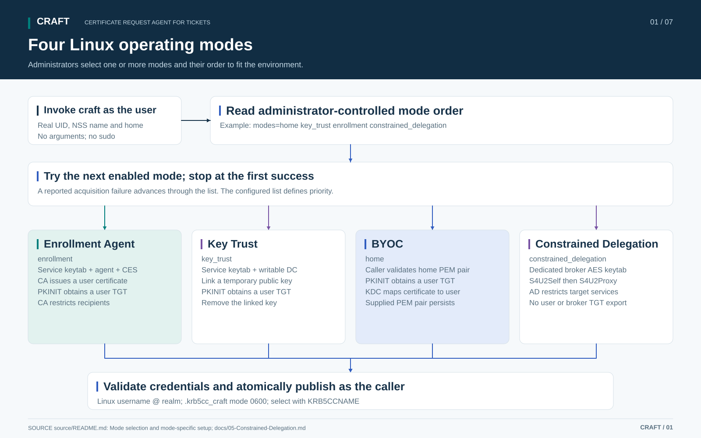

# CRAFT Certificate Request Agent for Tickets

CRAFT is a versatile Kerberos credential solution for Linux, including hosts that are not domain-joined. Administrators select and order one or more operating modes to fit their environment's PKI, directory capabilities and application needs. Three modes use certificate authentication (PKINIT) to obtain a user's ticket-granting ticket (TGT); a fourth uses broker-account constrained delegation to obtain selected service tickets. CRAFT publishes a private cache for unattended scripts and Kerberos-aware applications without storing the user's Active Directory password.

## Choose operating modes

| Mode | Credential and authorization | Linux installation | Guides |
| --- | --- | --- | --- |
| **Enrollment Agent** (`enrollment`) | AD CS issues a temporary user certificate through CES; the CA restricts the enrollment agent, template and recipients. | Setuid launcher and dedicated service account | [Setup](source/README.md#enrollment-agent-setup) · [Flow](docs/diagrams/02-enrollment-sequence.svg) |
| **Key Trust** (`key_trust`) | CRAFT temporarily adds a public key to the user's `msDS-KeyCredentialLink`; scoped AD delegation authorizes the write. | Setuid launcher and dedicated service account | [Setup](source/README.md#key-trust-setup) · [Flow](docs/diagrams/03-credential-linking-sequence.svg) |
| **BYOC - Bring Your Own Cert** (`home`) | The user enrolls and exports a certificate on Windows, transfers the PEM pair to Linux, and the KDC maps it to the account. | Ordinary executables running as the caller | [Setup](source/README.md#byoc-setup) · [Flow](docs/diagrams/04-windows-exported-certificate.svg) |
| **Constrained Delegation** (`constrained_delegation`) | The broker uses S4U2Self/S4U2Proxy; AD restricts delegation to approved service SPNs. | Setuid launcher and dedicated service account | [Setup](source/README.md#constrained-delegation-setup) · [Flow](docs/diagrams/07-constrained-delegation.svg) |

Enrollment Agent, Key Trust and BYOC are the certificate modes. Enrollment Agent, Key Trust and Constrained Delegation are the broker modes and require privileged installation.

Set the ordered `modes` list in `/etc/craft/config`. For example, `modes=home enrollment` tries a caller-owned `~/.config/craft/user.pem` and `user.key` pair, then enrollment if that attempt fails. `modes=key_trust enrollment` prefers directory linking and falls back to AD CS. Only listed modes may run, and the first successful acquisition supplies the cache. Invalid configuration, an interrupted worker, failed directory cleanup or cache-publication failure stops the request; if no mode succeeds, the existing cache remains unchanged.

Use **`modes=constrained_delegation` alone to enforce service-ticket-only operation**. Including a certificate mode explicitly permits a TGT through that mode. `modes=home` requires only ordinary executables and a valid PEM pair. See [mode selection](source/README.md#configure-mode-selection) for ordering, prerequisites and failure behavior.

Users run `craft` directly, without `sudo`. All modes request `<Linux username>@<configured realm>`, validate the returned credentials and publish a caller-owned mode-0600 `.krb5cc_craft` in the home resolved by the Linux account database (NSS). Certificate and network processing run as the caller or the dedicated service account. Every mode needs administrator-controlled Kerberos configuration. Certificate modes need KDC certificate trust and current CRLs; Enrollment Agent and BYOC also validate the user certificate's CA chain and revocation.



## Compile install and validate

Install the [Linux dependencies](source/README.md#build), then compile as an ordinary user:

```sh
git clone https://github.com/nomorefood/craft.git
cd craft
cmake -S source -B build -DCMAKE_BUILD_TYPE=Release
cmake --build build -j2
ctest --test-dir build --output-on-failure
```

Complete [shared Linux installation](source/README.md#shared-linux-installation), then the setup for each enabled mode. Broker modes also need the [privileged installation](source/README.md#shared-privileged-installation). Configuration ships disabled; replace the examples, provision trust and credentials, and complete the [deployment acceptance checks](source/TESTING.md) before production use.

## Use the ticket cache

Run as the intended non-root Linux user:

```sh
cache=$(/usr/local/bin/craft) || exit "$?"
export KRB5CCNAME="$cache"
klist -ef -c "$KRB5CCNAME"
```

In certificate modes, Kerberos-aware applications launched from that shell use the cache to obtain service tickets for SMB, LDAP and Kerberos-enabled web services. Access follows the user's existing permissions. CRAFT requests ten-hour TGT validity, seven-day renewal and AES256/AES128 encryption; the KDC controls the grant. Strict validation rejects shortened grants. Administrators can explicitly accept them with `require_full_tgt_lifetime=no`.

Constrained Delegation preloads only the configured service SPNs. It publishes no user/broker TGT or S4U2Self evidence, and cannot obtain additional service tickets. The KDC may shorten `service_ticket_seconds`; CRAFT accepts shorter valid AES tickets. See [broker delegation setup and limits](docs/05-Constrained-Delegation.md).

For applications that should use tickets without reading the source cache, see [optional GSS-Proxy and SELinux setup](docs/06-GSS-Proxy-and-SELinux.md). It provides a separate application account, a proxy configuration example, an optional application wrapper and a SELinux cache-label policy. Direct cache access remains the default.

For long-running jobs, start maintenance once from the job script:

```sh
job_pid=$$
cache=$(/usr/local/bin/craft-maintain --watch-pid "$job_pid") || exit "$?"
export KRB5CCNAME="$cache"
```

TGT renewal uses the cache alone. Constrained Delegation refreshes the entire service batch through the broker before its earliest ticket expires. Fresh authentication invokes `craft` with the same mode selection. Maintenance stops with the watched job and leaves the cache. Replace supplied certificates before expiry; ticket maintenance does not renew them. See [long-running jobs](source/README.md#long-running-jobs) for scheduler requirements and status.

## Administrator documentation

| Guide | Purpose |
| --- | --- |
| [Build installation and configuration](source/README.md) | Dependencies, installation recipes, all configuration settings, Windows helpers and troubleshooting |
| [Process overview](docs/01-CRAFT-Process-Overview.docx) ([PDF](docs/01-CRAFT-Process-Overview.pdf)) | Operating modes, identity, credential storage and ticket lifecycle |
| [Configuration and validation](docs/02-CRAFT-Configuration-and-Validation.docx) ([PDF](docs/02-CRAFT-Configuration-and-Validation.pdf)) | Printable mode requirements, configuration and acceptance checks |
| [Enrollment-agent restrictions](docs/03-Enrollment-Agent-Restrictions.md) | Enrollment Agent CA authorization and denial tests |
| [Key Trust delegation](docs/04-Key-Credential-Link-Delegation.md) | Key Trust directory permissions, cleanup and denial tests |
| [Constrained delegation](docs/05-Constrained-Delegation.md) | Constrained Delegation broker/SPN policy and service-only acceptance |
| [GSS-Proxy and SELinux](docs/06-GSS-Proxy-and-SELinux.md) | Optional isolated application access, alternate deployment instructions and cache labels |
| [Deployment validation](source/TESTING.md) | Offline checks, recorded coverage and live acceptance |
| [Security and operations](source/SECURITY.md) | Credential authority, trust boundaries and operational disable |

[All diagrams (PDF)](docs/CRAFT-Diagrams.pdf). Individual SVGs: [mode selection](docs/diagrams/01-system-overview.svg), [enrollment](docs/diagrams/02-enrollment-sequence.svg), [credential linking](docs/diagrams/03-credential-linking-sequence.svg), [Windows export](docs/diagrams/04-windows-exported-certificate.svg), [credential timing](docs/diagrams/05-credential-timing.svg), [job maintenance](docs/diagrams/06-job-maintenance.svg), and [constrained delegation](docs/diagrams/07-constrained-delegation.svg).

## Validation scope

Recorded AD lab runs cover Ubuntu 24.04.5 LTS and Rocky Linux 9.8 clients, Windows Server 2022 AD/AD CS/CES, and Windows Server 2019/2025 member servers. Additional Linux build and MIT KDC checks have narrower scope. See the [validation record](source/TESTING.md#recorded-validation) for results and limitations; other deployments need their own acceptance checks.

CRAFT is a reference implementation. It does not perform an MFA challenge or establish that one was completed. Protect the host, enrollment authority, directory delegation, supplied keys and ticket caches. Removing credentials, stopping maintenance or deleting a cache does not revoke already-issued tickets. No real credentials are bundled.

## License

Source code, scripts, configuration examples and documentation are licensed under [GNU GPL version 3 only](LICENSE) (`GPL-3.0-only`).
